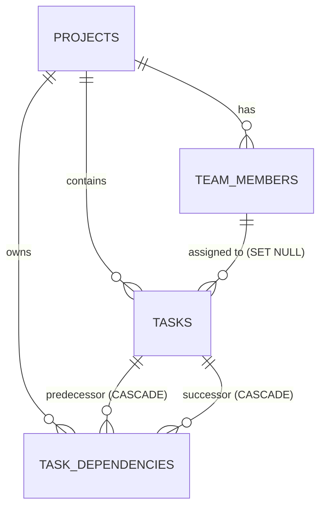

# NexusPM — Living Engineering Notebook & Rebuild Blueprint

> **Purpose:** This living document records the architecture, requirements, data models, mathematical formulas, design decisions, development log, common errors, and knowledge checkpoints for rebuilding **NexusPM** from a blank folder without assistance.

---

## 1. Project Overview
**NexusPM** is a full-stack Project Management and Operations Research web application. It enables engineering teams to manage projects, tasks, team members, and task dependencies as a **Directed Acyclic Graph (DAG)**, analyze schedule duration and critical bottlenecks via the **Critical Path Method (CPM)**, quantify deadline risk using **PERT 3-point statistical estimates**, and compute mathematically optimal schedules under daily resource limits (**Labor**, **Equipment**, **Budget**) using **Priority-Rule Heuristics (SSGS/PSGS)** and **Constraint Programming (CP-SAT / Branch-and-Bound)**.

---

## 2. Architecture
```
[Browser UI (HTML/CSS/JS + SVG)]
       │  HTTP JSON (fetch)
       ▼
[Unified REST Dispatcher (backend/app.py: dispatch_api_request)]
       ├──► [SQLite Persistence Layer (backend/database.py)] ──► [project_management.db]
       └──► [Pure Algorithm Engine (backend/algorithms/*.py)]
               ├── dag.py       (Kahn's Topological Sort, 3-Color DFS Cycle Detection, Gating)
               ├── cpm.py       (Forward/Backward Pass, ES/EF/LS/LF, Total & Free Float)
               ├── pert.py      (TE, Variance, Z-Score, Normal CDF Bell Curve)
               ├── workload.py  (Team Capacity, Hours, Cost, Utilization Status)
               └── rcpsp.py     (Schedule Verifier, SSGS/PSGS Heuristics, CP-SAT Optimizer)
```

---

## 3. Technology Stack
| Layer | Technology | Role |
| :--- | :--- | :--- |
| Language | Python 3.10+ | Backend logic, graph algorithms, constraint optimization |
| Database | SQLite (`sqlite3`) | Embedded relational persistence with foreign keys |
| Web Server | FastAPI / Tornado / `http.server` | HTTP server & static file hosting |
| Optimization | OR-Tools CP-SAT + Native B&B | Exact solver for resource-constrained scheduling |
| Frontend | HTML5, CSS3, Vanilla JS + SVG | Interactive multi-tab UI and custom charts |
| Testing | `unittest` (`test.py`) | Automated verification of CRUD, DAG, PERT, CPM, and RCPSP |

---

## 4. Data Model (Completed in Phase 0)

### Why Edges Live in a Fixed-Column Table (`task_dependencies`)
- **Anti-Pattern 1 (Comma-separated string `"2,3"` in `tasks`):** Deleting Task 2 leaves a dangling ghost ID `"2"` inside Task 4, and SQL cannot enforce foreign keys or join on comma-separated text.
- **Anti-Pattern 2 (One column per task):** In SQL, columns are fixed schema definitions while rows are dynamic data. Creating a new task must insert a **row**, never alter table columns.
- **Relational Graph Pattern (Adjacency / Edge Table):** Each directed arrow `Predecessor -> Successor` is stored as one row in `task_dependencies(id, project_id, predecessor_id, successor_id)` with `ON DELETE CASCADE`.



### Hand-Traced 4-Task Diamond Benchmark
- **Tasks:** $A (3\text{d}, 1\text{L})$, $B (5\text{d}, 2\text{L})$, $C (2\text{d}, 2\text{L})$, $D (2\text{d}, 1\text{L})$
- **Edges:** $A \to B$, $A \to C$, $B \to D$, $C \to D$
- **Topological Orders:** `[A, B, C, D]` or `[A, C, B, D]`
- **Unconstrained CPM Schedule:**
  - $A$: $[0, 3]$
  - $B$: $[3, 8]$ (Critical)
  - $C$: $[3, 5]$ (Total Float = $8 - 5 = 3\text{ days}$)
  - $D$: $[\max(8, 5), 8 + 2] = [8, 10]$ (Project Makespan = **10 days**)
- **Resource-Constrained Schedule (`max_labor = 3`):**
  - $B$ and $C$ cannot overlap ($2 + 2 = 4 > 3$). They must run sequentially, increasing total makespan from **10 days** to **12 days** ($3 + 5 + 2 + 2 = 12$).

---

## 5. Feature List & Status
- [x] **Phase 0:** Paper Design (Requirements, Schema, API Contract, Hand-Traced Network)
- [x] **Phase 1:** SQLite Database & CRUD (`database.py`)
- [x] **Phase 2:** DAG Validation, Cycle Detection & Readiness Gating (`dag.py`)
- [ ] **Phase 3:** Critical Path Method — Forward/Backward Pass & Float (`cpm.py`)
- [ ] **Phase 4:** PERT Risk & Deadline Probability (`pert.py`)
- [ ] **Phase 5:** Team Workload Analytics (`workload.py`)
- [ ] **Phase 6:** RCPSP Verifier, Heuristics & CP-SAT Optimizer (`rcpsp.py`)
- [ ] **Phase 7:** Unified REST API Dispatcher (`app.py`)
- [ ] **Phase 8:** Interactive Frontend & SVG Visualizations (`app.js`, `index.html`)
- [ ] **Phase 9:** Testing, Debugging Drills & Refactoring (`test.py`)
- [ ] **Phase 10:** Blank-Folder Rebuild & Extension Challenge

---

## 6. Development Log
- **Session 1:** Initialized mentorship roadmap and completed Phase 0 (Paper Design).
- **Session 2:** Completed Phase 1 (SQLite Database & CRUD). Mastered parameterized SQL queries (`conn.execute(sql, tuple)`), `LEFT JOIN` vs. `INNER JOIN`, foreign key rules (`ON DELETE CASCADE` vs. `ON DELETE SET NULL`), and defensive 3-swap sorting for $O \le M \le P$.
- **Session 3:** Completed Phase 2 (DAG Engine). Mastered Adjacency Lists (`predecessors` & `successors`), Kahn's topological sort (`in_degree == 0`), 3-color DFS (`WHITE` = unvisited, `GRAY` = active path / cycle if revisited, `BLACK` = finished safe diamond merge), and task readiness gating.

---

## 7. Design Decisions
1. **Pure Algorithm Functions:** All modules in `backend/algorithms/` accept plain Python `list` and `dict` objects and never touch `sqlite3`. *Why:* Enables fast unit testing and complete decoupling from database details.
2. **Single Dispatcher Function (`dispatch_api_request`):** All HTTP routes flow through one pure dispatcher returning `(status_code, dict)`. *Why:* Allows direct testing without network sockets and supports multiple web servers.

---

## 8. Common Errors & Debugging Notes
- **`TypeError: list indices must be integers or slices, not str`**: Happens when iterating `for t in dependencies:` and mistakenly indexing the outer list `dependencies["predecessor_id"]` instead of the loop item `t["predecessor_id"]`.
- **2-Color vs. 3-Color DFS on Diamonds**: Marking visited nodes with only `True`/`False` falsely reports a cycle on diamond merges ($A \to B \to D$ and $A \to C \to D$). Only hitting a **`GRAY`** (currently active) node is a cycle; hitting a **`BLACK`** (already finished) node is safe.
- **SQLite Foreign Keys Disabled by Default**: Every new `sqlite3` connection must execute `PRAGMA foreign_keys = ON;`.

---

## 9. Personal Knowledge Gaps & Checkpoints
*Tracked at the end of each phase.*
